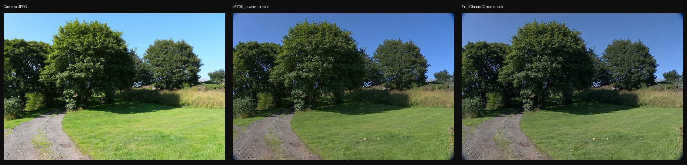

# a6700_rawsmith


**EN** — An AI-friendly RAW developer for the **Sony α6700**, built as a Python
sister project to [rawsmith](https://github.com/Lewin671/rawsmith). It decodes
an α6700 ARW file and develops it into a finished picture from a small JSON
recipe — and adds a **Fujifilm-style LUT look** that rawsmith does not cover.

**中文** — 一个面向 AI 助手的 **Sony α6700** RAW 开发工具，作为
[rawsmith](https://github.com/Lewin671/rawsmith) 的 Python 姊妹项目。它把 α6700 的
ARW 文件按一份小小的 JSON recipe 开发成成品照片，并额外提供 rawsmith 尚未覆盖的
**富士风格 LUT 外观**。

---

## How it relates to rawsmith · 与 rawsmith 的关系

rawsmith is a from-scratch **Rust engine that deliberately avoids LibRaw** —
that is its whole point, and it is impressive. This project does **not** try to
replace it. It sits alongside it on purpose:

| | rawsmith | a6700_rawsmith |
|---|---|---|
| Engine | own Rust, **no LibRaw** | Python on **rawpy (LibRaw)** |
| Camera | Sony A7 IV | Sony **α6700** |
| Look | tone/colour | + **Fujifilm `.cube` LUT** looks |
| Recipes | JSON | JSON, **interchangeable** (see below) |

So: **rawsmith is the reference, this is a LibRaw-backed cross-check** for a
different body and a different aesthetic. The recipes are compatible — you can
convert one to the other:

```bash
a6700_rawsmith to-rawsmith   my-recipe.json   # → rawsmith-compatible JSON
a6700_rawsmith from-rawsmith rawsmith.json    # → a6700 recipe (fills defaults)
```

## Install · 安装

```bash
pip install a6700_rawsmith
```

Requires Python ≥ 3.10. `rawpy` pulls in `libraw` automatically on first import.

## Quick start · 快速上手

```bash
# Develop a real α6700 ARW file
a6700_rawsmith develop DSC01234.ARW -o preview.jpg

# Auto-develop with a conservative starting recipe
a6700_rawsmith auto DSC01234.ARW -o preview.jpg

# Inspect RAW metadata (sizes, white balance, ISO/shutter/aperture/focal)
a6700_rawsmith inspect DSC01234.ARW

# Print the full recipe schema
a6700_rawsmith schema

# Run the test suite (real-RAW tests auto-skip without a sample)
python -m pytest tests -q
```

### Before / after · 前后对比

Developed from a real CC0 α6700 file ([raw.pixls.us](https://raw.pixls.us)):
camera's own JPEG vs `a6700_rawsmith auto` vs a Fujifilm Classic Chrome look.



## Python API · Python 接口

```python
from a6700_rawsmith import develop, make_test_image, SCHEMA

# Develop a real RAW file
result = develop(
    "DSC01234.ARW",
    recipe={"exposure": 0.3, "shadows": 20, "vibrance": 15},
    out="preview.jpg",
    size=1400,
)
print(result.stats)      # tone percentiles, clipping, a 3×3 brightness grid
print(result.warnings)   # anything a recipe got wrong, reported not hidden

# No camera? Generate a synthetic scene and exercise the pipeline
make_test_image("scene.jpg", width=800, height=600)
```

## The pipeline · 处理管线

Adjustments run in **scene-linear float** space (values proportional to light,
middle grey at 0.18) and only map to sRGB gamma at the very end — so exposure
and tone behave the way a photographer expects. Order:

1. **Decode** — rawpy → 16-bit linear, camera or recipe white balance
2. **Tone** — exposure, highlights, shadows, whites, blacks, contrast
3. **Local** — dehaze, clarity, denoise
4. **Colour** — saturation, vibrance, per-band HSL, split-tone grade
5. **Detail** — unsharp-mask sharpness
6. **Look** — optional Fujifilm `.cube` LUT (a6700 extension)
7. **Encode + geometry** — sRGB gamma, rotate, crop, resize

## Recipe format · Recipe 格式

A JSON object; only changed keys are needed, defaults merge automatically.
Shared keys (`exposure`, `highlights`, `shadows`, `whites`, `blacks`,
`contrast`, `clarity`, `dehaze`, `vibrance`, `crop`) are the same as rawsmith's.

```json
{
  "exposure": 0.2,
  "highlights": -30,
  "shadows": 25,
  "contrast": 15,
  "vibrance": 15,
  "sharpness": 50,
  "temperature": 5600,
  "hsl": { "orange": { "saturation": 15, "luminance": -5 } },
  "grade": { "shadows": { "hue": 210, "sat": 0.3 }, "highlights": { "hue": 35, "sat": 0.2 } },
  "crop": { "top": 0.05, "bottom": 0.95 },
  "a6700": { "creative_look": "FL", "fuji_lut_path": "examples/luts/fuji_classic_chrome.cube" }
}
```

### Parameters · 参数

| Parameter | Range | Default | Notes · 说明 |
|-----------|-------|---------|------|
| `exposure` | −5 … 5 stops | 0 | linear-light gain |
| `temperature` | 2000 … 10000 K | null | anchored on camera daylight WB |
| `tint` | −100 … 100 | null | green–magenta shift |
| `highlights` / `shadows` / `whites` / `blacks` | −100 … 100 | 0 | luminance-zone tone |
| `contrast` | −100 … 100 | 0 | pivot at 0.18 linear |
| `clarity` | −100 … 100 | 0 | local contrast (large-radius) |
| `dehaze` | −100 … 100 | 0 | midtone contrast + haze lift |
| `saturation` / `vibrance` | −100 … 100 | 0 | vibrance spares already-saturated pixels |
| `sharpness` | 0 … 100 | 40 | unsharp mask, colour-preserving |
| `denoise` | 0 … 100 | 10 | chroma smoothing, detail-preserving |
| `rotate` | −45 … 45° | 0 | horizon correction |
| `crop` | normalised 0–1 | `{}` | top/bottom/left/right |
| `hsl` | per-band hue/sat/lum −100…100 | `{}` | 8 hue bands |
| `grade` | shadows/highlights hue+sat | `{}` | split toning |
| `a6700.creative_look` | ST/PT/NT/VV/VV2/FL/IN/SH/BW/SE | — | metadata |
| `a6700.picture_profile` | PP1–6/10/11 | — | metadata |
| `a6700.fuji_lut_path` | path to `.cube` | — | **a6700-only look** |

### Honest limits · 如实说明的边界

- **White balance** is a monotonic, bounded approximation anchored on the
  camera's daylight WB — it is not a full chromaticity solve. It never
  diverges, but it is a reference implementation, not Lightroom.
- **Lens correction** (distortion / vignetting) is not applied.
- **A `.cube` LUT failure is reported in `warnings`, never swallowed.**

## Testing without a camera · 无相机测试

`make_test_image()` generates a synthetic scene (the historical name
`make_test_arw()` is kept as an alias, but it produces a raster, not a real
RAW). For real-RAW coverage, fetch a CC0 α6700 sample — tests auto-skip if it
is absent, so CI stays green without a 43 MB download:

```bash
bash scripts/fetch_sample.sh          # → tests/fixtures/ILCE-6700.ARW (not committed)
A6700_SAMPLE=tests/fixtures/ILCE-6700.ARW python -m pytest tests -q
```

## Status · 状态

- [x] Real α6700 ARW decode (rawpy 16-bit linear)
- [x] Scene-linear tone/colour pipeline
- [x] All recipe parameters actually applied (guarded by regression tests)
- [x] Fujifilm `.cube` LUT application
- [x] rawsmith recipe interop (`to-rawsmith` / `from-rawsmith`)
- [x] CI on Python 3.10–3.13, real-RAW test when a sample is present
- [ ] Batch develop command
- [ ] Recipe diff / merge tool
- [ ] Per-camera colour-matrix white balance

## Credits · 致谢

Inspired by **Lewin671**, whose
[rawsmith](https://github.com/Lewin671/rawsmith) showed that a RAW developer
could be small, readable, and made for an AI editing loop. Any credit for the
ideas belongs to them; any bugs here are mine.

本项目受 **Lewin671** 的 [rawsmith](https://github.com/Lewin671/rawsmith)
启发。想法的功劳归于 ta，这里的 bug 算我的。

## License · 许可

MIT


### Repeated RAW edits and memory / 重复调图与内存

`develop()` reuses one process-local, pre-adjustment RAW preview when the input
file identity, modification/change timestamps, size, output size and white
balance parameters match. Tone, LUT and geometry are always reapplied. The
retained pixel buffer is capped at 64 MiB; larger previews and full-resolution
images over that budget are not cached. Switching inputs releases the old cache
before decoding the new one. No cache files are written to disk.

Repeated calls in one Python process benefit; separate CLI invocations do not
share the cache. Call `clear_raw_cache()` to release it between editing sessions:

```python
from a6700_rawsmith import develop, clear_raw_cache

develop("photo.ARW", {"exposure": 0.1}, "first.jpg", size=1400)
develop("photo.ARW", {"exposure": 0.3}, "second.jpg", size=1400)
clear_raw_cache()
```

同一 Python 进程连续调图会复用一张调色前的预览，像素缓存上限 64 MiB，
不写磁盘；独立启动的 CLI 不共享缓存。源文件、尺寸或白平衡改变会失效，
调色、LUT 和几何变换仍重新执行。会话结束可用 `clear_raw_cache()` 释放。
缓存按文件系统身份与时间戳校验，不支持在文件正被其他程序写入时进行可靠快照。
全图转 8-bit 时按行分块，避免建立多个全尺寸临时浮点数组。

Concurrent cache misses decode independently; different files are not serialized.
同时发生的缓存未命中可各自解码，不保证并发同键请求合并；单个缓存槽仍受容量限制。


### AI editing across commands / 跨命令复用调图缓存

The session worker requires macOS or Linux; the original engine API is unchanged.
For a local checkout with its Python dependencies installed, run the lightweight
client instead of starting a new engine for every preview:

```sh
python a6700_session.py develop /absolute/photo.ARW --set exposure=0.1 -o first.jpg
python a6700_session.py develop /absolute/photo.ARW --set exposure=0.3 -o second.jpg
python a6700_session.py status
python a6700_session.py stop
```

The first edit starts an idle-expiring worker. Later clients use an owner-only
Unix socket and the existing 64 MiB RAM preview cache. Default idle expiry is
600 seconds; no login item or TCP listener is registered. Replies wrap the
engine output in `result` and add `worker` diagnostics (`pid`, `raw_decodes`,
`cache_bytes`). `clear` releases the pixel cache; `status` never starts a worker.
Relative LUT paths resolve in the calling directory, matching the original CLI.
The original CLI and Python API remain available.

每条客户端命令仍可独立退出，处理进程保留至空闲超时或显式 `stop`。
源码变更后下一次编辑会更换旧 worker。请求回复丢失时先检查输出和状态，
不要盲目重发；处理可能已经写出图片。单个 worker 顺序处理调图请求。
`auto` 和原 CLI 一样会在输入旁写 recipe sidecar，普通迭代优先用 `develop`。
